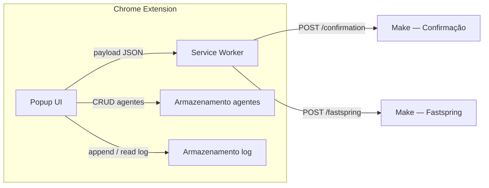

# PRD — Snov.io Support Webhook Extension

**Produto:** extensão Chrome (Manifest V3) para agentes de suporte da Snov.io enviarem dados estruturados a cenários Make via webhook.
**Versão do documento:** 2.0
**Idiomas da interface:** português (BR), English, Español, Українська — alternável pelo botão de idioma no header (ciclo PT → EN → ES → UA)
**Documentação no repositório:** `README.md` na raiz é a fonte canónica **em inglês**. Traduções do README: `translations/README.*`. **PRD (este ficheiro):** português (BR), especificação técnica interna. **Traduções do PRD (mesma versão):** `translations/PRD.en.md`, `PRD.es.md`, `PRD.uk.md` — ver `translations/PRD-INDEX.md`.

---

## 1. Visão geral

Ferramenta interna que padroniza o envio de:

1. **Link de confirmação** para um destinatário (email + URL).
2. **Requisições relacionadas à Fastspring** (reabilitar compra, troca de email da área de cobrança, alteração de dados de invoice, desbloqueio de conta), com campos condicionais conforme o motivo.

O Make recebe JSON via `POST` e roteia por `type` e, quando aplicável, por `reason_code`.

---

## 2. Personas e contexto

- **Usuário primário:** agente de suporte humano (campo "Agente" identifica quem enviou).
- **Ambiente:** Chrome, instalação não compactada ou empacotada para uso interno.
- **Autenticação do produto:** nenhuma na v1 (confiança operacional + distribuição controlada).

---

## 3. Arquitetura (alto nível)



| Componente | Responsabilidade |
|------------|------------------|
| **Popup** | Formulários, validação, **três botões** na barra (Fastspring, Confirmação, Log), painel **Settings** só pelo **ícone de engrenagem** no header, notificações laterais, modal Sobre, Log com reenvio. |
| **Service worker** | `fetch` ao webhook correto (conforme `payload.type`) com timeout; carrega `config.js` via `importScripts`. |
| **Agentes** | Persistência local até limpeza de dados do site/extensão — **localStorage** (v1). |
| **Log de envios** | Histórico na sessão de uso — **`chrome.storage.session`** (requisito); limite FIFO (ver §8). |

**Dois webhooks fixos (v1.5):**

| Destino | URL | Acionado quando |
|---------|-----|-----------------|
| Confirmação | `https://hook.us1.make.com/73ml73lfd9re85rwleyedp72gendmljg` | `type === 'confirmation_link'` |
| Fastspring | `https://hook.us1.make.com/3pgd7kidmcen1nro986dw9b2u42sijtw` | `type === 'fastspring_request'` |

Fonte única de verdade: `config.js` (`WEBHOOK_CONFIRMATION_URL`, `WEBHOOK_FASTSPRING_URL`). O service worker lê via `importScripts('config.js')` e roteia pelo `payload.type`.

Permissões mínimas no manifest: `storage`; `host_permissions` apenas para `https://hook.us1.make.com/*`.

---

## 4. Stack técnica

- HTML5, CSS3, JavaScript vanilla.
- Manifest V3; CSP de extension pages: `script-src 'self'`, sem scripts inline.
- Ícones da extensão (toolbar / gestão): `icons/icons top right/Extension icon/ei24.png`, `ei64.png`, `ei128.png` (nomes **só ASCII** no caminho). No `manifest`, a chave `48` reutiliza `ei64.png`. **Ícones das abas** (popup): `icons/fastspring32.png`, `icons/linkdeconfrimação32.png`, `icons/log32.png`.

---

## 5. Branding e UX

### 5.1 Paleta (CSS: variáveis em `:root`)

| Token | Hex (referência) | Uso |
|-------|------------------|-----|
| Primária | `#7C3AED` | Botão **Enviar**, focus, **bordas de inputs** |
| Primária escura | `#6D28D9` | Hover, ênfase |
| Primária BG suave | `#EDE9FE` | Backgrounds de hover |
| **Header** | `#FFFFFF` | Fundo do header e abas |
| Texto | `#1A1A2E` | Texto principal |
| Texto secundário | `#374151` | Labels, hints |
| Secundário | `#6B7280` | Labels, hints |
| Borda | `#E5E7EB` | Divisores, cards, **inputs usam `--color-primary`** |

### 5.2 Layout

- Largura do popup: **436px**; altura mínima 240px, altura máxima **700px** com scroll. Shell com **cantos arredondados** (`border-radius: 12px`) + **borda roxa** (`1.5px solid #7C3AED`). O `html` usa `background-color: var(--color-header-bg)` (`#FFFFFF`) para evitar "frestas" nos cantos.
- **Header:** fundo branco (`#FFFFFF`), borda inferior cinza (`1px solid #E5E7EB`). Header + barra de abas dentro do wrapper `.top-chrome` com `border-radius` superior interno e `overflow: hidden`. **Logo** `icons/icons top right/Extension icon/ei64.png` (26×26) ao lado do título **"Snov.io Support Tools"** em roxo (`#7C3AED`). No canto superior direito (ordem): **Language** → **Settings** → **About** (ícones reduzidos ~40%).
- **Navegação — barra de abas:** primeira linha **Fastspring** (largura total); segunda linha **Confirmação** e **Log** em duas colunas. **Não há** botão de Settings na barra — o painel de configurações abre apenas pelo **ícone de engrenagem** no header.

  | Estado | Comportamento |
  |--------|---------------|
  | **Inativo** | Fundo cinza claro (`#F3F4F6`), texto escuro `#374151`, ícone **cinza** (`grayscale(100%) brightness(0.65)`) |
  | **Hover (inativo)** | Fundo acento da aba (teal/azul/lavanda), texto colorido, ícone **colorido** |
  | **Ativo (selecionado)** | Fundo claro da cor da aba + borda de 2px no acento, ícone **colorido** |

  Acentos: Confirmação → azul `#3B82F6`; Fastspring → teal `#0D9488`; Log → lavanda `#7c52c8`.

- **Inputs / selects / textareas:** borda `1.5px solid var(--color-primary)` (`#aa7cf6`); focus com anel roxo suave.
- **Conteúdo:** fundo branco, padding confortável.
- **Notificações:** painel lateral direito, slide-in, auto-dismiss (~1.8s).

### 5.3 Princípios

- Contraste forte roxo/branco; cantos arredondados (mín. 8px nos elementos).
- Microinterações: hover/focus/active em controles.
- Botão **Enviar:** estado de carregamento com classe `.is-loading`; hover suprimido quando select está aberto (`form.select-open .btn-submit`).

### 5.4 Feedback (notificações)

- Notificações **laterais** (direita do popup), empilháveis, animação entrada/saída, remoção automática após **~1.8s**.
- Tipos: `success` e `error`.

---

## 6. Funcionalidades por aba

### 6.1 Aba "Link de confirmação"

**Campos:** Email do destinatário · Link de confirmação · Agente · **Enviar**.

**Payload:**

```json
{
  "type": "confirmation_link",
  "email": "usuario@email.com",
  "confirmation_link": "https://...",
  "agent_name": "Nome do agente",
  "timestamp": "2026-03-31T14:30:00.000Z"
}
```

**Pós-envio (sucesso):** notificação lateral, registro no log, limpar campos.

---

### 6.2 Aba "Fastspring"

**Fluxo em dois passos (UX):**

1. **Primeiro** só o **Motivo da requisição** (select) é mostrado.
2. **Depois** de escolher um motivo válido, aparecem: **Email do destinatário**, blocos condicionais (se aplicável), **Agente** e **Enviar**. Se o utilizador voltar a "Selecione o motivo", o segundo passo oculta-se e os campos são limpos.

**Motivos disponíveis** (UI traduzida via `i18n.js`, chaves `fs-reason-*`):

| `reason_code` | PT | EN | ES | UA |
|---|---|---|---|---|
| `whitelist` | Reabilitar Compra | Re-enable Purchase | Rehabilitar Compra | Повторна активація покупки |
| `email_change` | Atualizar o Email de Acesso ao Painel de Cobrança | Update Billing Email | Actualizar Correo de Cobro | Зміна email для оплати |
| `invoice_data_change` | Atualizar Dados da Fatura | Update Invoice Data | Actualizar Datos de Factura | Оновлення даних рахунку |
| `account_unblock` | Desbloquear Conta | Unblock Account | Desbloquear Cuenta | Розблокування облікового запису |

**Campos condicionais:**

- `email_change`: exibe **From** (email antigo) + **To** (novo email), ambos obrigatórios.
- `invoice_data_change`: exibe **textarea** "descrição das alterações", obrigatória.
- `whitelist` e `account_unblock`: sem campos extras; validação: email + agente apenas.

**Estrutura do payload (todos os motivos):**

```json
{
  "type": "fastspring_request",
  "reason_code": "<slug>",
  "reason": "<texto em inglês — usado pelo Make nos e-mails>",
  "email": "usuario@email.com",
  "agent_name": "Nome",
  "timestamp": "2026-03-31T14:30:00.000Z"
}
```

Campos adicionais por motivo:

| Motivo | Campos extras no payload |
|--------|--------------------------|
| `email_change` | `email_from`, `email_to` |
| `invoice_data_change` | `notes` |
| `whitelist`, `account_unblock` | — |

O mapa `reason` (EN) vem de `CONFIG.FASTSPRING_REASON_EN` em `config.js`, garantindo texto estável para o Make **independentemente** do idioma da UI. As etiquetas visíveis no select usam `data-i18n` com chaves `fs-reason-placeholder`, `fs-reason-whitelist`, `fs-reason-email-change`, `fs-reason-invoice-data`, `fs-reason-account-unblock`.

**Reenvio a partir do Log:** para `fastspring_request`, o campo `reason` é recalculado com `FASTSPRING_REASON_EN[reason_code]` para manter inglês mesmo em entradas antigas gravadas com outro texto.

---

### 6.3 Aba "Log"

- Lista cronológica dos envios bem-sucedidos (tipo, email/referência, agente, hora).
- Histórico válido **até fechar o navegador** (`chrome.storage.session`, chave `snovio_log`).
- Cada entrada guarda o **payload completo** e exibe botão **Reenviar** (↻) que reenvia com timestamp atualizado.
- Botão **Limpar** zera o armazenamento da sessão — alinhado à **direita** na mesma linha do título "Log" / "Submission Log"; texto de ajuda abaixo com tipografia mais legível.
- Badge numérico na aba Log quando houver entradas.
- `getLogTypeLabel` mapeia `reason_code` para chaves `fs-reason-*` e usa `t()` no idioma atual; índice de fallback `payload.reason_code || payload.reason` para compatibilidade retroativa.

---

### 6.4 Painel "Settings" (só via header)

> **Nota:** O painel **Settings** **não** tem botão na barra de abas. É aberto exclusivamente pelo **ícone de engrenagem** no header (ou programaticamente). O **idioma** é alternado pelo botão com ícone de idioma no header (ciclo PT → EN → ES → UA).

**Funcionalidades disponíveis:**
- **Cadastro de agentes:** adicionar nome, listar, remover. Persiste em `localStorage` (`snovio_agents`).

**Modal "Sobre":** acessível pelo **ícone de informação no header** (último botão). Exibe:
- Nome do produto
- Versão
- Texto interno
- **Reportar bug** com email `fg@snov.io` e botão para copiar

---

## 7. Contrato com o Make

- **Método:** `POST`
- **Header:** `Content-Type: application/json`
- **Roteamento por webhook:**
  - `type: confirmation_link` → webhook de confirmação
  - `type: fastspring_request` → webhook Fastspring

- **Cenário Fastspring:** filtrar por `type: fastspring_request`; usar `reason_code` (slug estável) para roteamento interno; usar `reason` (EN) nos templates de e-mail.
- **Sucesso HTTP:** tratar 2xx como sucesso; erros pós-webhook são responsabilidade do fluxo Make.

---

## 8. Log de envios

- **Persistência:** `chrome.storage.session` (chave `snovio_log`): sobrevive ao fechar/reabrir o popup, **limpa ao encerrar o navegador**.
- **Limite:** 100 entradas, FIFO.
- Ação **Limpar** remove todas as entradas.

---

## 9. Validação e erros

- Email: formato válido; campos obrigatórios marcados.
- URL de confirmação: URL válida.
- Fastspring: sem motivo selecionado, só erro no select de motivo (email/agente não validados até haver `reason_code`).
- Fastspring `email_change`: `email_from` e `email_to` obrigatórios e válidos.
- Fastspring `invoice_data_change`: `notes` obrigatório.
- Fastspring `whitelist` / `account_unblock`: validar apenas email + agente.
- Falha de rede / HTTP não-2xx: notificação lateral de erro; timeout **10s**.
- Feedback inline nos campos com erro (borda + mensagem).

---

## 10. Segurança e privacidade

- URLs dos webhooks estão no pacote da extensão — **não são segredos**; mitigação: distribuição restrita, rotação das URLs no Make se vazar.
- Dados enviados contêm **PII** (e-mails, links, notas); conformidade interna (LGPD/GDPR) e acesso aos cenários Make devem ser controlados.
- CSP restritiva; sem permissões de host desnecessárias.

---

## 11. Fora de escopo (v1)

- Webhooks configuráveis pela UI.
- Histórico persistente entre reinícios do navegador.
- Autenticação de agente na extensão.
- Publicação na Chrome Web Store.

---

## 12. Critérios de aceite (smoke)

1. Carregar extensão sem erros no `chrome://extensions`.
2. Cadastrar agente e ver selects preenchidos nas abas Confirmação e Fastspring.
3. Enviar confirmação: Make recebe `type: confirmation_link` no webhook de confirmação.
4. Enviar Fastspring para cada `reason_code`; payloads batem com §6.2; webhook Fastspring recebe corretamente.
5. Log atualiza e respeita limite; limpar zera lista; reabrir popup mantém entradas na mesma sessão.
6. Erro simulado exibe notificação lateral; botão **Enviar** volta ao estado normal.
7. Alternar idioma pelo header: toda UI traduz; `reason_code` no payload permanece slug estável independente do idioma.
8. Abas inativas mostram ícones acinzentados; hover mostra ícones coloridos; aba ativa mantém ícones coloridos.

---

## 13. Estrutura de repositório (referência)

```
Tool Extension/
  README.md          ← documentação principal (inglês)
  PRD.md
  translations/
    README.md        ← índice das traduções do README
    PRD-INDEX.md     ← índice das traduções do PRD
    README.pt-BR.md
    README.es.md
    README.uk.md
    PRD.en.md
    PRD.es.md
    PRD.uk.md
  manifest.json
  popup.html
  popup.css
  popup.js
  i18n.js
  background.js      ← importScripts('config.js') na 1ª linha
  config.js          ← fonte única: WEBHOOK_*, REQUEST_TIMEOUT_MS, MAX_LOG_ENTRIES,
                        VERSION, FASTSPRING_REASON_EN
  docs/
    project-approval/
      README.md              ← aprovação interna (EN): Make, Gmail, botões, Drive
    sugestoes-e-melhorias/
      README.md              ← fluxo Google Docs / export .docx
      GOOGLE_DOCS_LINK.txt   ← URL do doc colaborativo (editável)
  icons/
    fastspring32.png
    linkdeconfrimação32.png
    log32.png
    icons top right/
      Extension icon/
        ei24.png
        ei64.png
        ei128.png
      settings.png
      language.png
      about.png
```

---

## 14. Notas de implementação

| Requisito | Observação |
|-----------|------------|
| Dois webhooks | `background.js` roteia pelo `payload.type`; URLs lidas de `CONFIG` via `importScripts('config.js')`. |
| Payload Fastspring | `reason_code` (slug, estável) + `reason` (EN, `CONFIG.FASTSPRING_REASON_EN`). UI: chaves `fs-reason-*` em `i18n.js`. |
| Log / etiquetas | `getLogTypeLabel` usa mapa `FASTSPRING_REASON_I18N_KEYS` + `t()`; fallback `payload.reason_code \|\| payload.reason`. |
| Fastspring passo a passo | `#fs-after-reason` oculto até haver `reason_code`; `updateFastspringReasonStep()` em `popup.js`. |
| Log cabeçalho | `.log-tab-header-top`: título + botão Limpar à direita; `.log-tab-hint` tipografia legível. |
| Botão Enviar | Estado de loading via `.is-loading`; hover suprimido com `form.select-open` enquanto select está aberto. |
| i18n | `i18n.js` com dicionário PT/EN/ES/UA. Alternador cíclico no header (PT→EN→ES→UA), persiste em `localStorage`. |
| Bordas de inputs | `1.5px solid var(--color-primary)` (`#7C3AED`) — consistente com o foco. |
| Ícones das abas | Inativo: cinza (`grayscale(100%) brightness(0.65)`). Hover/ativo: colorido original. |
| Ícones do header | Language (primeiro), Settings, About — tamanhos reduzidos (~40%). |
| Ícones da extensão | `icons/icons top right/Extension icon/ei24`, `ei64`, `ei128`. |
| Barra de abas | 3 botões: Fastspring (full), Confirmação + Log. Settings **sem** botão na barra — só ícone engrenagem no header. |
| Layout responsivo | Popup 436px, máx 700px: Fastspring linha completa; Confirmação + Log em duas colunas. |
| Suporte a idiomas | PT, EN, ES, UA (Українська). Ciclo no alternador: PT→EN→ES→UA. |
| README / traduções | Raiz: `README.md` em **inglês**. `translations/`: README PT-BR, ES, UA + índice. Atualizar EN primeiro, depois alinhar traduções. |
| PRD / traduções | Raiz: `PRD.md` (PT). `translations/PRD.en.md`, `PRD.es.md`, `PRD.uk.md` + `PRD-INDEX.md` — versão **sincronizada** (2.0). |
| Aprovação de projeto | `docs/project-approval/README.md` (EN): Make (2 webhooks), Gmail, comportamento de cada controlo, Drive, LI Prospect Finder. |

**Versão do documento:** 2.0 — PRD alinhado ao código (Settings só pelo header; 3 botões na barra); conjunto de PRDs em **4 idiomas** (`PRD.md` + `translations/PRD.*`). Ícones de aba na raiz de `icons/`: `fastspring32.png`, `linkdeconfrimação32.png`, `log32.png`. Herda 1.9 (project-approval, etc.).

---

*Fim do PRD.*
