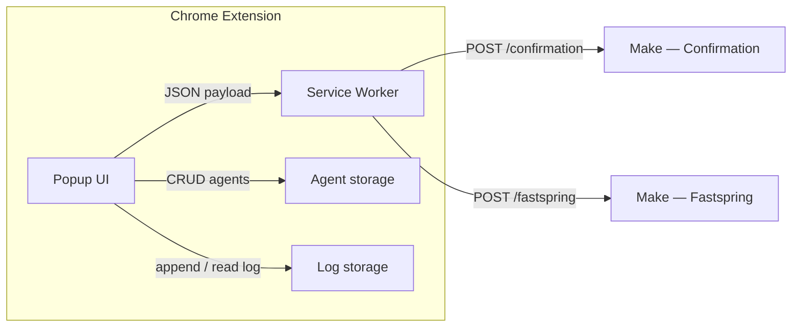

# PRD — Snov.io Support Webhook Extension

**Product:** Chrome extension (Manifest V3) for Snov.io support agents to send structured data to Make scenarios via webhook.  
**Document version:** 2.0  
**UI languages:** Portuguese (BR), English, Spanish, Ukrainian — toggled from the header language control (cycle PT → EN → ES → UA)  
**Repository documentation:** Root `README.md` is the canonical **English** user doc. README translations: `translations/README.*`. **PRD:** this English file is a **translation** of the Portuguese canonical spec [`../PRD.md`](../PRD.md). Other PRD languages: `PRD.es.md`, `PRD.uk.md` — see [`PRD-INDEX.md`](PRD-INDEX.md).

---

## 1. Overview

Internal tool that standardizes sending:

1. **Confirmation link** to a recipient (email + URL).  
2. **Fastspring-related requests** (re-enable purchase, billing panel access email change, invoice data change, account unblock), with conditional fields per reason.

Make receives JSON via `POST` and routes by `type` and, when applicable, by `reason_code`.

---

## 2. Personas and context

- **Primary user:** human support agent (the **Agent** field identifies who sent the request).  
- **Environment:** Chrome, unpacked or packed build for internal use.  
- **Product authentication:** none in v1 (operational trust + controlled distribution).

---

## 3. Architecture (high level)



| Component | Responsibility |
|-----------|------------------|
| **Popup** | Forms, validation, **three buttons** in the tab bar (Fastspring, Confirmation, Log), **Settings** panel **only** via the **gear icon** in the header, side notifications, About modal, Log with resend. |
| **Service worker** | `fetch` to the correct webhook (by `payload.type`) with timeout; loads `config.js` via `importScripts`. |
| **Agents** | Local persistence until site/extension data is cleared — **localStorage** (v1). |
| **Submission log** | Session-scoped history — **`chrome.storage.session`** (requirement); FIFO cap (see §8). |

**Two fixed webhooks (v1.5):**

| Target | URL | Triggered when |
|--------|-----|----------------|
| Confirmation | `https://hook.us1.make.com/73ml73lfd9re85rwleyedp72gendmljg` | `type === 'confirmation_link'` |
| Fastspring | `https://hook.us1.make.com/3pgd7kidmcen1nro986dw9b2u42sijtw` | `type === 'fastspring_request'` |

Single source of truth: `config.js` (`WEBHOOK_CONFIRMATION_URL`, `WEBHOOK_FASTSPRING_URL`). The service worker reads via `importScripts('config.js')` and routes by `payload.type`.

Minimum manifest permissions: `storage`; `host_permissions` only for `https://hook.us1.make.com/*`.

---

## 4. Technical stack

- HTML5, CSS3, vanilla JavaScript.  
- Manifest V3; extension pages CSP: `script-src 'self'`, no inline scripts.  
- Extension icons (toolbar / management): `icons/icons top right/Extension icon/ei24.png`, `ei64.png`, `ei128.png` (**ASCII-only** path segments). In `manifest`, key `48` reuses `ei64.png`. **Tab icons** (popup): `icons/fastspring32.png`, `icons/linkdeconfrimação32.png`, `icons/log32.png`.

---

## 5. Branding and UX

### 5.1 Palette (CSS `:root` variables)

| Token | Hex (reference) | Use |
|-------|-----------------|-----|
| Primary | `#7C3AED` | **Submit** button, focus, **input borders** |
| Primary dark | `#6D28D9` | Hover, emphasis |
| Primary soft BG | `#EDE9FE` | Hover backgrounds |
| **Header** | `#FFFFFF` | Header and tab bar background |
| Text | `#1A1A2E` | Main text |
| Secondary text | `#374151` | Labels, hints |
| Secondary | `#6B7280` | Labels, hints |
| Border | `#E5E7EB` | Dividers, cards; **inputs use `--color-primary`** |

### 5.2 Layout

- Popup width: **436px**; min height 240px, max **700px** with scroll. Shell **rounded** (`border-radius: 12px`) + **purple border** (`1.5px solid #7C3AED`). `html` uses `background-color: var(--color-header-bg)` (`#FFFFFF`) to avoid corner gaps.  
- **Header:** white (`#FFFFFF`), bottom gray border (`1px solid #E5E7EB`). Header + tab bar inside `.top-chrome` with internal top radius and `overflow: hidden`. **Logo** `icons/icons top right/Extension icon/ei64.png` (26×26) next to **"Snov.io Support Tools"** in purple (`#7C3AED`). Top-right order: **Language** → **Settings** → **About** (icons ~40% smaller).  
- **Tab bar:** first row **Fastspring** (full width); second row **Confirmation** and **Log** in two columns. **No** Settings tab button — Settings opens only from the **gear** in the header.

  | State | Behavior |
  |-------|----------|
  | **Inactive** | Light gray bg (`#F3F4F6`), dark text `#374151`, **gray** icon (`grayscale(100%) brightness(0.65)`) |
  | **Hover (inactive)** | Tab accent bg (teal/blue/lavender), colored text, **colored** icon |
  | **Active (selected)** | Light accent bg + 2px accent border, **colored** icon |

  Accents: Confirmation → blue `#3B82F6`; Fastspring → teal `#0D9488`; Log → lavender `#7c52c8`.

- **Inputs / selects / textareas:** border `1.5px solid var(--color-primary)` (`#aa7cf6`); soft purple focus ring.  
- **Content:** white background, comfortable padding.  
- **Notifications:** right-side panel, slide-in, auto-dismiss (~1.8s).

### 5.3 Principles

- Strong purple/white contrast; rounded corners (min. 8px on controls).  
- Micro-interactions: hover/focus/active.  
- **Submit:** loading state via `.is-loading`; hover suppressed while a `<select>` is open (`form.select-open .btn-submit`).

### 5.4 Feedback (notifications)

- **Side** notifications (right of popup), stackable, enter/exit animation, auto-remove after **~1.8s**.  
- Types: `success` and `error`.

---

## 6. Features by tab / panel

### 6.1 Tab: Confirmation link

**Fields:** Recipient email · Confirmation link · Agent · **Submit**.

**Payload:**

```json
{
  "type": "confirmation_link",
  "email": "user@email.com",
  "confirmation_link": "https://...",
  "agent_name": "Agent name",
  "timestamp": "2026-03-31T14:30:00.000Z"
}
```

**After successful send:** side notification, log entry, clear form.

---

### 6.2 Tab: Fastspring

**Two-step UX:**

1. **First**, only **Request reason** (`<select>`) is visible.  
2. **After** a valid reason is chosen: **Recipient email**, conditional blocks (if any), **Agent**, and **Submit** appear. If the user returns to the placeholder option, step two hides and fields are cleared.

**Available reasons** (UI translated via `i18n.js`, keys `fs-reason-*`):

| `reason_code` | PT | EN | ES | UA |
|---|---|---|---|---|
| `whitelist` | Reabilitar Compra | Re-enable Purchase | Rehabilitar Compra | Повторна активація покупки |
| `email_change` | Atualizar o Email de Acesso ao Painel de Cobrança | Update Billing Email | Actualizar Correo de Cobro | Зміна email для оплати |
| `invoice_data_change` | Atualizar Dados da Fatura | Update Invoice Data | Actualizar Datos de Factura | Оновлення даних рахунку |
| `account_unblock` | Desbloquear Conta | Unblock Account | Desbloquear Cuenta | Розблокування облікового запису |

**Conditional fields:**

- `email_change`: **From** (old email) + **To** (new email), both required.  
- `invoice_data_change`: **textarea** for change description, required.  
- `whitelist` and `account_unblock`: no extra fields; validate email + agent only.

**Payload shape (all reasons):**

```json
{
  "type": "fastspring_request",
  "reason_code": "<slug>",
  "reason": "<English text — used by Make in emails>",
  "email": "user@email.com",
  "agent_name": "Name",
  "timestamp": "2026-03-31T14:30:00.000Z"
}
```

Extra fields by reason:

| Reason | Extra payload fields |
|--------|----------------------|
| `email_change` | `email_from`, `email_to` |
| `invoice_data_change` | `notes` |
| `whitelist`, `account_unblock` | — |

The `reason` (EN) map comes from `CONFIG.FASTSPRING_REASON_EN` in `config.js`, stable for Make **regardless** of UI language. Visible select labels use `data-i18n` keys `fs-reason-placeholder`, `fs-reason-whitelist`, `fs-reason-email-change`, `fs-reason-invoice-data`, `fs-reason-account-unblock`.

**Resend from Log:** for `fastspring_request`, `reason` is recomputed with `FASTSPRING_REASON_EN[reason_code]` so English is preserved even for older log entries.

---

### 6.3 Tab: Log

- Chronological list of successful sends (type, email/reference, agent, time).  
- History lasts **until the browser is fully closed** (`chrome.storage.session`, key `snovio_log`).  
- Each row stores the **full payload** and a **Resend** (↻) button (new `timestamp` on resend).  
- **Clear** wipes session storage — **right-aligned** on the same row as the log title; hint text below with larger readable typography.  
- Numeric **badge** on the Log tab when entries exist.  
- `getLogTypeLabel` maps `reason_code` to `fs-reason-*` and uses `t()` in the current UI language; fallback key `payload.reason_code || payload.reason` for backward compatibility.

---

### 6.4 Settings panel (header only)

> **Note:** **Settings** has **no** tab-bar button. It opens only from the **gear** icon in the header (or programmatically). **Language** cycles via the language control (PT → EN → ES → UA).

**Features:**
- **Agent registry:** add name, list, remove. Persisted in `localStorage` (`snovio_agents`).

**About modal:** opened from the **info** icon (last header button). Shows product name, version, internal disclaimer, **Report a bug** with `fg@snov.io` and copy button.

---

## 7. Make contract

- **Method:** `POST`  
- **Header:** `Content-Type: application/json`  
- **Webhook routing:**  
  - `type: confirmation_link` → confirmation webhook  
  - `type: fastspring_request` → Fastspring webhook  

- **Fastspring scenario:** filter on `type: fastspring_request`; use `reason_code` for internal routing; use `reason` (EN) in email templates.  
- **HTTP success:** treat 2xx as success; downstream errors are Make’s responsibility.

---

## 8. Submission log

- **Persistence:** `chrome.storage.session` (`snovio_log`): survives popup close/reopen, **clears when the browser exits**.  
- **Cap:** 100 entries, FIFO.  
- **Clear** removes all entries.

---

## 9. Validation and errors

- Email: valid format; required fields enforced.  
- Confirmation URL: valid URL.  
- Fastspring: if no reason selected, only the reason field errors (email/agent not validated until `reason_code` is set).  
- Fastspring `email_change`: `email_from` and `email_to` required and valid.  
- Fastspring `invoice_data_change`: `notes` required.  
- Fastspring `whitelist` / `account_unblock`: email + agent only.  
- Network / non-2xx HTTP: side error notification; timeout **10s** (from `config.js`).  
- Inline errors on invalid fields (border + message).

---

## 10. Security and privacy

- Webhook URLs ship in the extension package — **not treated as secrets**; mitigate with restricted distribution; rotate in Make if leaked.  
- Payloads may contain **PII** (emails, links, notes); internal compliance (LGPD/GDPR) and Make scenario access must be controlled.  
- Strict CSP; no unnecessary host permissions.

---

## 11. Out of scope (v1)

- Webhooks configurable from the UI.  
- Persistent history across browser restarts.  
- Agent authentication inside the extension.  
- Chrome Web Store publication.

---

## 12. Acceptance criteria (smoke)

1. Extension loads without errors in `chrome://extensions`.  
2. Register an agent; Confirmation and Fastspring dropdowns populate.  
3. Send confirmation: Make receives `type: confirmation_link` on the confirmation webhook.  
4. Send Fastspring for each `reason_code`; payloads match §6.2; Fastspring webhook receives correctly.  
5. Log updates and respects cap; Clear empties list; reopening popup keeps entries in the same session.  
6. Simulated failure shows side notification; **Submit** returns to normal state.  
7. Header language toggle: full UI translates; `reason_code` in payload stays a stable slug regardless of language.  
8. Inactive tabs show grayed icons; hover shows color; active tab keeps colored icons.

---

## 13. Repository structure (reference)

```
Tool Extension/
  README.md          ← main user doc (English)
  PRD.md             ← canonical PRD (Portuguese)
  translations/
    README.md
    PRD-INDEX.md
    README.pt-BR.md
    README.es.md
    README.uk.md
    PRD.en.md
    PRD.es.md
    PRD.uk.md
  manifest.json
  popup.html
  popup.css
  popup.js
  i18n.js
  background.js      ← importScripts('config.js') first line
  config.js          ← WEBHOOK_*, REQUEST_TIMEOUT_MS, MAX_LOG_ENTRIES,
                        VERSION, FASTSPRING_REASON_EN
  docs/
    project-approval/
      README.md
    sugestoes-e-melhorias/
      README.md
      GOOGLE_DOCS_LINK.txt
  icons/
    fastspring32.png
    linkdeconfrimação32.png
    log32.png
    icons top right/
      Extension icon/
        ei24.png
        ei64.png
        ei128.png
      settings.png
      language.png
      about.png
```

---

## 14. Implementation notes

| Requirement | Notes |
|-------------|-------|
| Two webhooks | `background.js` routes by `payload.type`; URLs from `CONFIG` via `importScripts('config.js')`. |
| Fastspring payload | `reason_code` (stable slug) + `reason` (EN, `CONFIG.FASTSPRING_REASON_EN`). UI: `fs-reason-*` in `i18n.js`. |
| Log labels | `getLogTypeLabel` uses `FASTSPRING_REASON_I18N_KEYS` + `t()`; fallback `payload.reason_code \|\| payload.reason`. |
| Fastspring steps | `#fs-after-reason` hidden until `reason_code`; `updateFastspringReasonStep()` in `popup.js`. |
| Log header | `.log-tab-header-top`: title + Clear on the right; `.log-tab-hint` readable typography. |
| Submit button | Loading via `.is-loading`; hover suppressed with `form.select-open` while select is open. |
| i18n | `i18n.js` PT/EN/ES/UA; header cycle (PT→EN→ES→UA), persisted in `localStorage`. |
| Input borders | `1.5px solid var(--color-primary)` (`#7C3AED`). |
| Tab icons | Inactive: gray filter; hover/active: full color. |
| Header icons | Language, Settings, About — reduced size (~40%). |
| Extension icons | `icons/icons top right/Extension icon/ei24`, `ei64`, `ei128`. |
| Tab bar | 3 buttons: Fastspring (full row), Confirmation + Log. Settings **no** tab — gear in header only. |
| Responsive layout | Popup 436px, max 700px: Fastspring full width row; Confirmation + Log two columns. |
| Languages | PT, EN, ES, UA. Cycle: PT→EN→ES→UA. |
| README translations | Root `README.md` EN; `translations/` README PT-BR, ES, UA. Update EN first. |
| PRD translations | Canonical [`../PRD.md`](../PRD.md) (PT); `PRD.en.md`, `PRD.es.md`, `PRD.uk.md` + `PRD-INDEX.md` — sync version **2.0**. |
| Project approval | [`../docs/project-approval/README.md`](../docs/project-approval/README.md) (EN): Make, Gmail, controls, Drive. |

**Document version:** 2.0 — Aligned with code (Settings header-only; three tab buttons); multilingual PRD set; tab icons under `icons/` root as listed. Inherits 1.9 (project-approval, etc.).

---

*End of PRD.*
