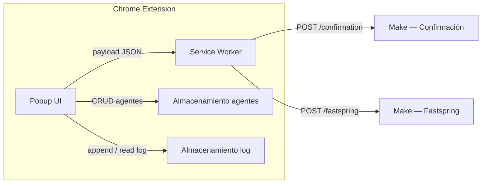

# PRD — Extensión webhook Snov.io Support

**Producto:** extensión Chrome (Manifest V3) para que los agentes de soporte de Snov.io envíen datos estructurados a escenarios de Make mediante webhook.  
**Versión del documento:** 2.0  
**Idiomas de la interfaz:** portugués (BR), inglés, español, ucraniano — conmutación desde el control de idioma del encabezado (ciclo PT → EN → ES → UA)  
**Documentación del repositorio:** `README.md` en la raíz es el documento de usuario canónico en **inglés**. Traducciones del README: `translations/README.*`. **PRD:** este archivo en español es una **traducción** del PRD canónico en portugués [`../PRD.md`](../PRD.md). Otros idiomas del PRD: `PRD.en.md`, `PRD.uk.md` — ver [`PRD-INDEX.md`](PRD-INDEX.md).

---

## 1. Visión general

Herramienta interna que estandariza el envío de:

1. **Enlace de confirmación** a un destinatario (correo + URL).  
2. **Solicitudes relacionadas con Fastspring** (rehabilitar compra, cambio de correo de acceso al panel de facturación, cambio de datos de factura, desbloqueo de cuenta), con campos condicionales según el motivo.

Make recibe JSON mediante `POST` y enruta por `type` y, cuando aplica, por `reason_code`.

---

## 2. Personas y contexto

- **Usuario principal:** agente humano de soporte (el campo **Agente** identifica quién envió).  
- **Entorno:** Chrome, compilación sin empaquetar o empaquetada para uso interno.  
- **Autenticación del producto:** ninguna en v1 (confianza operativa + distribución controlada).

---

## 3. Arquitectura (alto nivel)



| Componente | Responsabilidad |
|------------|------------------|
| **Popup** | Formularios, validación, **tres botones** en la barra (Fastspring, Confirmación, Log), panel **Settings** **solo** con el **icono de engranaje** del encabezado, notificaciones laterales, modal Acerca de, Log con reenvío. |
| **Service worker** | `fetch` al webhook correcto (según `payload.type`) con timeout; carga `config.js` con `importScripts`. |
| **Agentes** | Persistencia local hasta limpiar datos del sitio/extensión — **localStorage** (v1). |
| **Log de envíos** | Historial de sesión — **`chrome.storage.session`** (requisito); límite FIFO (ver §8). |

**Dos webhooks fijos (v1.5):**

| Destino | URL | Se dispara cuando |
|---------|-----|-------------------|
| Confirmación | `https://hook.us1.make.com/73ml73lfd9re85rwleyedp72gendmljg` | `type === 'confirmation_link'` |
| Fastspring | `https://hook.us1.make.com/3pgd7kidmcen1nro986dw9b2u42sijtw` | `type === 'fastspring_request'` |

Fuente única de verdad: `config.js` (`WEBHOOK_CONFIRMATION_URL`, `WEBHOOK_FASTSPRING_URL`). El service worker lee con `importScripts('config.js')` y enruta por `payload.type`.

Permisos mínimos del manifiesto: `storage`; `host_permissions` solo para `https://hook.us1.make.com/*`.

---

## 4. Stack técnico

- HTML5, CSS3, JavaScript vanilla.  
- Manifest V3; CSP de páginas de extensión: `script-src 'self'`, sin scripts inline.  
- Iconos de la extensión: `icons/icons top right/Extension icon/ei24.png`, `ei64.png`, `ei128.png` (rutas **solo ASCII**). En `manifest`, la clave `48` reutiliza `ei64.png`. **Iconos de pestañas** (popup): `icons/fastspring32.png`, `icons/linkdeconfrimação32.png`, `icons/log32.png`.

---

## 5. Marca y UX

### 5.1 Paleta (variables CSS `:root`)

| Token | Hex (referencia) | Uso |
|-------|------------------|-----|
| Primaria | `#7C3AED` | Botón **Enviar**, focus, **bordes de inputs** |
| Primaria oscura | `#6D28D9` | Hover, énfasis |
| Primaria BG suave | `#EDE9FE` | Fondos de hover |
| **Encabezado** | `#FFFFFF` | Fondo del header y barra de pestañas |
| Texto | `#1A1A2E` | Texto principal |
| Texto secundario | `#374151` | Etiquetas, hints |
| Secundario | `#6B7280` | Etiquetas, hints |
| Borde | `#E5E7EB` | Divisores, tarjetas; **inputs usan `--color-primary`** |

### 5.2 Diseño

- Ancho del popup: **436px**; altura mín. 240px, máx. **700px** con scroll. Contenedor con **esquinas redondeadas** (`border-radius: 12px`) + **borde morado** (`1.5px solid #7C3AED`).  
- **Encabezado:** blanco, borde inferior gris. Logo `ei64.png` junto a **"Snov.io Support Tools"** en morado. Esquina superior derecha: **Idioma** → **Ajustes** → **Acerca de**.  
- **Barra de pestañas:** primera fila **Fastspring** (ancho completo); segunda fila **Confirmación** y **Log** en dos columnas. **No hay** botón de Settings en la barra — solo el **engranaje** del header.

  | Estado | Comportamiento |
  |--------|----------------|
  | **Inactivo** | Fondo gris claro, texto oscuro, icono **gris** |
  | **Hover (inactivo)** | Fondo de acento, texto e icono **coloridos** |
  | **Activo** | Fondo claro del acento + borde 2px, icono **colorido**

  Acentos: Confirmación → azul `#3B82F6`; Fastspring → teal `#0D9488`; Log → lavanda `#7c52c8`.

- **Inputs / selects / textareas:** borde `1.5px solid var(--color-primary)`; focus morado suave.  
- **Notificaciones:** panel lateral derecho, auto-cierre ~1.8s.

### 5.3 Principios

- Contraste fuerte morado/blanco; esquinas redondeadas (mín. 8px).  
- **Enviar:** estado de carga `.is-loading`; hover suprimido con `form.select-open` si el select está abierto.

### 5.4 Notificaciones

- Tipos: `success` y `error`.

---

## 6. Funcionalidades por pestaña / panel

### 6.1 Pestaña: Enlace de confirmación

**Campos:** Email del destinatario · Enlace de confirmación · Agente · **Enviar**.

**Payload:**

```json
{
  "type": "confirmation_link",
  "email": "usuario@email.com",
  "confirmation_link": "https://...",
  "agent_name": "Nombre del agente",
  "timestamp": "2026-03-31T14:30:00.000Z"
}
```

**Tras envío correcto:** notificación lateral, registro en el log, limpiar campos.

---

### 6.2 Pestaña: Fastspring

**Flujo en dos pasos (UX):**

1. **Primero** solo se muestra el **Motivo de la solicitud** (select).  
2. **Después** de elegir un motivo válido aparecen: **Email del destinatario**, bloques condicionales (si aplica), **Agente** y **Enviar**. Si el usuario vuelve a la opción placeholder, el segundo paso se oculta y se limpian los campos.

**Motivos disponibles** (UI traducida vía `i18n.js`, claves `fs-reason-*`):

| `reason_code` | PT | EN | ES | UA |
|---|---|---|---|---|
| `whitelist` | Reabilitar Compra | Re-enable Purchase | Rehabilitar Compra | Повторна активація покупки |
| `email_change` | Atualizar o Email de Acesso ao Painel de Cobrança | Update Billing Email | Actualizar Correo de Cobro | Зміна email для оплати |
| `invoice_data_change` | Atualizar Dados da Fatura | Update Invoice Data | Actualizar Datos de Factura | Оновлення даних рахунку |
| `account_unblock` | Desbloquear Conta | Unblock Account | Desbloquear Cuenta | Розблокування облікового запису |

**Campos condicionales:**

- `email_change`: **From** (email antiguo) + **To** (email nuevo), ambos obligatorios.  
- `invoice_data_change`: **textarea** de descripción de cambios, obligatoria.  
- `whitelist` y `account_unblock`: sin campos extra; validar solo email + agente.

**Estructura del payload (todos los motivos):**

```json
{
  "type": "fastspring_request",
  "reason_code": "<slug>",
  "reason": "<texto en inglés — usado por Make en los correos>",
  "email": "usuario@email.com",
  "agent_name": "Nombre",
  "timestamp": "2026-03-31T14:30:00.000Z"
}
```

Campos adicionales por motivo:

| Motivo | Campos extra en el payload |
|--------|----------------------------|
| `email_change` | `email_from`, `email_to` |
| `invoice_data_change` | `notes` |
| `whitelist`, `account_unblock` | — |

El mapa `reason` (EN) proviene de `CONFIG.FASTSPRING_REASON_EN` en `config.js`, estable para Make **independientemente** del idioma de la UI. Las etiquetas del select usan `data-i18n`: `fs-reason-placeholder`, `fs-reason-whitelist`, `fs-reason-email-change`, `fs-reason-invoice-data`, `fs-reason-account-unblock`.

**Reenvío desde el Log:** para `fastspring_request`, el campo `reason` se recalcula con `FASTSPRING_REASON_EN[reason_code]` para mantener inglés.

---

### 6.3 Pestaña: Log

- Lista cronológica de envíos correctos (tipo, email/referencia, agente, hora).  
- Historial válido **hasta cerrar el navegador** (`chrome.storage.session`, clave `snovio_log`).  
- Cada entrada guarda el **payload completo** y botón **Reenviar** (↻) con `timestamp` actualizado.  
- **Limpiar** vacía la sesión — alineado a la **derecha** en la misma línea que el título; texto de ayuda debajo con tipografía legible.  
- **Badge** numérico en la pestaña Log si hay entradas.  
- `getLogTypeLabel` mapea `reason_code` a claves `fs-reason-*` y usa `t()` en el idioma actual; fallback `payload.reason_code || payload.reason`.

---

### 6.4 Panel "Settings" (solo vía header)

> **Nota:** **Settings** **no** tiene botón en la barra de pestañas. Se abre solo con el **icono de engranaje** del header (o programáticamente). El **idioma** alterna con el control del header (ciclo PT → EN → ES → UA).

**Funciones:** registro de agentes (añadir, listar, eliminar) en `localStorage` (`snovio_agents`).

**Modal Acerca de:** icono de información del header. Muestra producto, versión, texto interno, **Reportar error** con `fg@snov.io` y copiar.

---

## 7. Contrato con Make

- **Método:** `POST`  
- **Cabecera:** `Content-Type: application/json`  
- **Enrutamiento:** `type: confirmation_link` → webhook confirmación; `type: fastspring_request` → webhook Fastspring.  
- **Escenario Fastspring:** filtrar por `type`; usar `reason_code` para enrutamiento interno; `reason` (EN) en plantillas de correo.  
- **HTTP:** 2xx = éxito; errores posteriores son responsabilidad del flujo Make.

---

## 8. Log de envíos

- **Persistencia:** `chrome.storage.session` (`snovio_log`): sobrevive cerrar/abrir el popup, **se borra al cerrar el navegador**.  
- **Límite:** 100 entradas, FIFO.  
- **Limpiar** elimina todas.

---

## 9. Validación y errores

- Email: formato válido.  
- URL de confirmación: URL válida.  
- Fastspring: sin motivo → solo error en el select de motivo (no se validan email/agente hasta tener `reason_code`).  
- `email_change`: `email_from` y `email_to` obligatorios y válidos.  
- `invoice_data_change`: `notes` obligatorio.  
- `whitelist` / `account_unblock`: solo email + agente.  
- Red / HTTP no 2xx: notificación de error; timeout **10s**.  
- Errores inline en campos.

---

## 10. Seguridad y privacidad

- URLs de webhook en el paquete — **no son secretos**; distribución restringida; rotar en Make si hay fuga.  
- Datos pueden incluir **PII**; cumplimiento interno (LGPD/GDPR) y acceso a escenarios Make controlados.  
- CSP restrictiva; sin permisos de host innecesarios.

---

## 11. Fuera de alcance (v1)

- Webhooks configurables desde la UI.  
- Historial persistente entre reinicios del navegador.  
- Autenticación del agente en la extensión.  
- Publicación en Chrome Web Store.

---

## 12. Criterios de aceptación (smoke)

1. Cargar la extensión sin errores en `chrome://extensions`.  
2. Registrar agente; selects de Confirmación y Fastspring se rellenan.  
3. Enviar confirmación: Make recibe `type: confirmation_link` en el webhook de confirmación.  
4. Enviar Fastspring para cada `reason_code`; payloads según §6.2; webhook Fastspring correcto.  
5. Log se actualiza y respeta el límite; Limpiar vacía la lista; reabrir popup mantiene entradas en la misma sesión.  
6. Error simulado muestra notificación lateral; **Enviar** vuelve al estado normal.  
7. Alternar idioma: toda la UI traduce; `reason_code` permanece slug estable.  
8. Pestañas inactivas: iconos grises; hover color; activa mantiene color.

---

## 13. Estructura del repositorio (referencia)

```
Tool Extension/
  README.md
  PRD.md
  translations/
    README.md
    PRD-INDEX.md
    README.pt-BR.md
    README.es.md
    README.uk.md
    PRD.en.md
    PRD.es.md
    PRD.uk.md
  manifest.json
  popup.html
  popup.css
  popup.js
  i18n.js
  background.js
  config.js
  docs/
    project-approval/
      README.md
    sugestoes-e-melhorias/
      README.md
      GOOGLE_DOCS_LINK.txt
  icons/
    fastspring32.png
    linkdeconfrimação32.png
    log32.png
    icons top right/
      Extension icon/
        ei24.png
        ei64.png
        ei128.png
      settings.png
      language.png
      about.png
```

---

## 14. Notas de implementación

| Requisito | Observación |
|-----------|-------------|
| Dos webhooks | `background.js` enruta por `payload.type`; URLs desde `CONFIG` vía `importScripts('config.js')`. |
| Payload Fastspring | `reason_code` + `reason` (EN, `FASTSPRING_REASON_EN`). UI: `fs-reason-*` en `i18n.js`. |
| Log / etiquetas | `getLogTypeLabel` con `FASTSPRING_REASON_I18N_KEYS` + `t()`; fallback `payload.reason_code \|\| payload.reason`. |
| Fastspring paso a paso | `#fs-after-reason` oculto hasta `reason_code`; `updateFastspringReasonStep()` en `popup.js`. |
| Cabecera del Log | `.log-tab-header-top`: título + Limpiar a la derecha; `.log-tab-hint` legible. |
| Botón Enviar | `.is-loading`; `form.select-open` con select abierto. |
| i18n | PT/EN/ES/UA; ciclo en header; `localStorage`. |
| Bordes inputs | `1.5px solid var(--color-primary)`. |
| Barra de pestañas | 3 botones: Fastspring (fila completa), Confirmación + Log. Settings solo engranaje. |
| Layout | Popup 436px, máx 700px: Fastspring ancho completo; Confirmación + Log dos columnas. |
| README / traducciones | Raíz `README.md` EN; `translations/` README PT-BR, ES, UA. |
| PRD / traducciones | Canónico [`../PRD.md`](../PRD.md) (PT); `PRD.en.md`, `PRD.es.md`, `PRD.uk.md` + `PRD-INDEX.md` — versión **2.0**. |
| Aprobación de proyecto | [`../docs/project-approval/README.md`](../docs/project-approval/README.md) (EN). |

**Versión del documento:** 2.0 — Alineado con el código y con [`../PRD.md`](../PRD.md) v2.0.

---

*Fin del PRD.*
