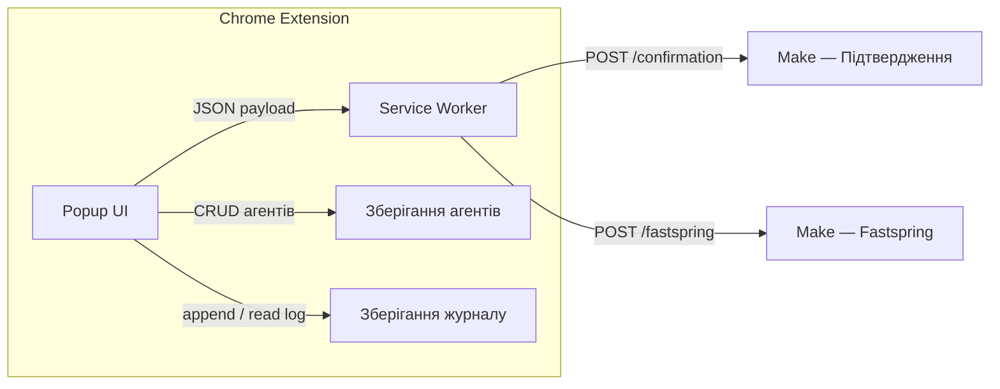

# PRD — розширення Snov.io Support Webhook

**Продукт:** розширення Chrome (Manifest V3) для агентів підтримки Snov.io надсилати структуровані дані в сценарії Make через webhook.  
**Версія документа:** 2.0  
**Мови інтерфейсу:** португальська (BR), англійська, іспанська, українська — перемикання кнопкою мови в заголовку (цикл PT → EN → ES → UA)  
**Документація в репозиторії:** кореневий `README.md` — канонічний **англійський** опис для користувачів. Переклади README: `translations/README.*`. **PRD:** цей файл — **переклад** канонічного PRD португальською [`../PRD.md`](../PRD.md). Інші мови PRD: `PRD.en.md`, `PRD.es.md` — див. [`PRD-INDEX.md`](PRD-INDEX.md).

---

## 1. Огляд

Внутрішній інструмент, що стандартизує надсилання:

1. **Посилання для підтвердження** отримувачу (email + URL).  
2. **Запитів щодо Fastspring** (повторна активація покупки, зміна email доступу до панелі білінгу, зміна даних інвойсу, розблокування облікового запису) з умовними полями залежно від причини.

Make отримує JSON методом `POST` і маршрутизує за `type` та за потреби за `reason_code`.

---

## 2. Персони та контекст

- **Основний користувач:** людина-агент підтримки (поле **Агент** ідентифікує відправника).  
- **Середовище:** Chrome, розпакована або пакована збірка для внутрішнього використання.  
- **Автентифікація продукту:** немає у v1 (операційна довіра + контрольований розповсюдження).

---

## 3. Архітектура (високий рівень)



| Компонент | Відповідальність |
|-----------|------------------|
| **Popup** | Форми, валідація, **три кнопки** на панелі вкладок (Fastspring, Підтвердження, Журнал), панель **Settings** **лише** через **іконку шестерні** в заголовку, бічні сповіщення, модальне «Про продукт», журнал із повторним надсиланням. |
| **Service worker** | `fetch` на правильний webhook (за `payload.type`) з таймаутом; завантажує `config.js` через `importScripts`. |
| **Агенти** | Локальне збереження до очищення даних сайту/розширення — **localStorage** (v1). |
| **Журнал відправок** | Історія в межах сесії — **`chrome.storage.session`** (вимога); ліміт FIFO (див. §8). |

**Два фіксовані webhook (v1.5):**

| Призначення | URL | Коли спрацьовує |
|-------------|-----|-----------------|
| Підтвердження | `https://hook.us1.make.com/73ml73lfd9re85rwleyedp72gendmljg` | `type === 'confirmation_link'` |
| Fastspring | `https://hook.us1.make.com/3pgd7kidmcen1nro986dw9b2u42sijtw` | `type === 'fastspring_request'` |

Єдине джерело правди: `config.js` (`WEBHOOK_CONFIRMATION_URL`, `WEBHOOK_FASTSPRING_URL`). Service worker читає через `importScripts('config.js')` і маршрутизує за `payload.type`.

Мінімальні дозволи маніфесту: `storage`; `host_permissions` лише для `https://hook.us1.make.com/*`.

---

## 4. Технічний стек

- HTML5, CSS3, vanilla JavaScript.  
- Manifest V3; CSP сторінок розширення: `script-src 'self'`, без inline-скриптів.  
- Іконки розширення: `icons/icons top right/Extension icon/ei24.png`, `ei64.png`, `ei128.png` (**лише ASCII** у шляхах). У `manifest` ключ `48` повторно використовує `ei64.png`. **Іконки вкладок** (popup): `icons/fastspring32.png`, `icons/linkdeconfrimação32.png`, `icons/log32.png`.

---

## 5. Брендинг та UX

### 5.1 Палітра (CSS `:root`)

| Токен | Hex | Використання |
|-------|-----|--------------|
| Основний | `#7C3AED` | Кнопка **Надіслати**, focus, **рамки полів** |
| Основний темний | `#6D28D9` | Hover, акцент |
| М’який фон | `#EDE9FE` | Hover-фони |
| **Заголовок** | `#FFFFFF` | Фон header і панелі вкладок |
| Текст | `#1A1A2E` | Основний текст |
| Другорядний | `#374151`, `#6B7280` | Підписи, підказки |
| Межа | `#E5E7EB` | Роздільники; поля використовують `--color-primary` |

### 5.2 Макет

- Ширина popup: **436px**; мін. висота 240px, макс. **700px** з прокруткою. Оболонка з заокругленням + фіолетова рамка.  
- **Заголовок:** білий фон, логотип `ei64.png`, назва **"Snov.io Support Tools"**. Справа зверху: **Мова** → **Налаштування** → **Про**.  
- **Панель вкладок:** перший ряд **Fastspring** на всю ширину; другий ряд **Підтвердження** та **Журнал** у двох колонках. **Немає** кнопки Settings на панелі — лише **шестерня** в заголовку.

  | Стан | Поведінка |
  |------|-----------|
  | **Неактивна** | Світло-сірий фон, сіра іконка (grayscale) |
  | **Hover** | Кольоровий акцент |
  | **Активна** | Світлий фон акценту + рамка 2px, кольорова іконка |

  Акценти: Підтвердження — синій `#3B82F6`; Fastspring — teal `#0D9488`; Журнал — лавандовий `#7c52c8`.

- **Поля вводу:** рамка `1.5px solid var(--color-primary)`; м’який фіолетовий focus.  
- **Сповіщення:** праворуч, авто-приховання ~1.8 с.

### 5.3–5.4 Принципи та сповіщення

- Контраст, заокруглення; кнопка надсилання з `.is-loading`; при відкритому `<select>` — `form.select-open` приглушує hover на submit.  
- Типи сповіщень: `success`, `error`.

---

## 6. Функції за вкладками / панелями

### 6.1 Вкладка: Посилання підтвердження

**Поля:** Email отримувача · Посилання підтвердження · Агент · **Надіслати**.

**Payload:**

```json
{
  "type": "confirmation_link",
  "email": "user@email.com",
  "confirmation_link": "https://...",
  "agent_name": "Ім'я агента",
  "timestamp": "2026-03-31T14:30:00.000Z"
}
```

**Після успіху:** бічне сповіщення, запис у журнал, очищення форми.

---

### 6.2 Вкладка: Fastspring

**Два кроки UX:**

1. **Спочатку** показується лише **Причина запиту** (select).  
2. **Після** вибору валідної причини з’являються: **Email отримувача**, умовні блоки (за потреби), **Агент** і **Надіслати**. Якщо користувач повертається до placeholder, другий крок ховається й поля очищаються.

**Доступні причини** (UI через `i18n.js`, ключі `fs-reason-*`):

| `reason_code` | PT | EN | ES | UA |
|---|---|---|---|---|
| `whitelist` | Reabilitar Compra | Re-enable Purchase | Rehabilitar Compra | Повторна активація покупки |
| `email_change` | Atualizar o Email de Acesso ao Painel de Cobrança | Update Billing Email | Actualizar Correo de Cobro | Зміна email для оплати |
| `invoice_data_change` | Atualizar Dados da Fatura | Update Invoice Data | Actualizar Datos de Factura | Оновлення даних рахунку |
| `account_unblock` | Desbloquear Conta | Unblock Account | Desbloquear Cuenta | Розблокування облікового запису |

**Умовні поля:**

- `email_change`: **From** (старий email) + **To** (новий email), обидва обов’язкові.  
- `invoice_data_change`: **textarea** опису змін, обов’язкова.  
- `whitelist` та `account_unblock`: без додаткових полів; валідація лише email + агент.

**Структура payload (усі причини):**

```json
{
  "type": "fastspring_request",
  "reason_code": "<slug>",
  "reason": "<англійський текст — для Make у листах>",
  "email": "user@email.com",
  "agent_name": "Ім'я",
  "timestamp": "2026-03-31T14:30:00.000Z"
}
```

Додаткові поля за причиною:

| Причина | Додаткові поля payload |
|---------|-------------------------|
| `email_change` | `email_from`, `email_to` |
| `invoice_data_change` | `notes` |
| `whitelist`, `account_unblock` | — |

Поле `reason` (EN) з `CONFIG.FASTSPRING_REASON_EN` у `config.js`, стабільне для Make **незалежно** від мови UI. Видимі підписи select: `fs-reason-placeholder`, `fs-reason-whitelist`, `fs-reason-email-change`, `fs-reason-invoice-data`, `fs-reason-account-unblock`.

**Повтор з журналу:** для `fastspring_request` поле `reason` перераховується через `FASTSPRING_REASON_EN[reason_code]`.

---

### 6.3 Вкладка: Журнал

- Хронологічний список успішних відправок (тип, email/посилання, агент, час).  
- Історія діє **до закриття браузера** (`chrome.storage.session`, ключ `snovio_log`).  
- Кожен запис зберігає **повний payload** і кнопку **Повторити** (↻) з оновленим `timestamp`.  
- **Очистити** обнулює сесію — **справа** в одному рядку з заголовком; підказка нижче з читабельною типографікою.  
- Числовий **бейдж** на вкладці Журнал за наявності записів.  
- `getLogTypeLabel` мапить `reason_code` на `fs-reason-*` і викликає `t()`; fallback `payload.reason_code || payload.reason`.

---

### 6.4 Панель «Settings» (лише через header)

> **Примітка:** **Settings** **немає** на панелі вкладок. Відкривається лише **іконкою шестерні** в заголовку (або програмно). **Мова** перемикається кнопкою в заголовку (цикл PT → EN → ES → UA).

**Функції:** реєстр агентів (додати, список, видалити) у `localStorage` (`snovio_agents`).

**Модальне «Про»:** іконка інформації в заголовку — назва продукту, версія, внутрішній текст, **Звіт про помилку** з `fg@snov.io` і копіюванням.

---

## 7. Контракт із Make

- **Метод:** `POST`  
- **Заголовок:** `Content-Type: application/json`  
- **Маршрутизація:** `type: confirmation_link` → webhook підтвердження; `type: fastspring_request` → webhook Fastspring.  
- **Сценарій Fastspring:** фільтр за `type`; внутрішній роутинг за `reason_code`; шаблони листів з `reason` (EN).  
- **HTTP:** 2xx = успіх; подальші помилки — зона відповідальності Make.

---

## 8. Журнал відправок

- **Зберігання:** `chrome.storage.session` (`snovio_log`): переживає закриття popup, **очищається при виході з браузера**.  
- **Ліміт:** 100 записів, FIFO.  
- **Очистити** видаляє всі записи.

---

## 9. Валідація та помилки

- Email: коректний формат.  
- URL підтвердження: валідний URL.  
- Fastspring: без вибраної причини — помилка лише на select причини (email/агент не валідуються, доки немає `reason_code`).  
- `email_change`: `email_from` і `email_to` обов’язкові та валідні.  
- `invoice_data_change`: `notes` обов’язковий.  
- `whitelist` / `account_unblock`: лише email + агент.  
- Мережа / HTTP не 2xx: бічне сповіщення про помилку; таймаут **10 с**.  
- Inline-помилки на полях (рамка + текст).

---

## 10. Безпека та приватність

- URL webhook у пакеті розширення — **не вважаються секретом**; обмежений розповсюдження; ротація в Make при витоку.  
- Payload може містити **PII** (email, посилання, нотатки); внутрішня відповідність (LGPD/GDPR) і доступ до сценаріїв Make мають бути контрольовані.  
- Сувора CSP; без зайвих host permissions.

---

## 11. Поза межами v1

- Webhooks, налаштовувані з UI.  
- Постійний журнал між перезапусками браузера.  
- Автентифікація агента в розширенні.  
- Публікація в Chrome Web Store.

---

## 12. Критерії приймання (smoke)

1. Завантаження розширення без помилок у `chrome://extensions`.  
2. Додати агента; випадаючі списки на формах Підтвердження та Fastspring заповнені.  
3. Надіслати підтвердження: Make отримує `type: confirmation_link` на webhook підтвердження.  
4. Надіслати Fastspring для кожного `reason_code`; payload відповідає §6.2; webhook Fastspring коректний.  
5. Журнал оновлюється й дотримується ліміту; Очистити спорожнює список; повторне відкриття popup зберігає записи в тій самій сесії.  
6. Симульована помилка показує бічне сповіщення; кнопка **Надіслати** повертається в норму.  
7. Перемикання мови: весь UI перекладається; `reason_code` у payload лишається стабільним slug.  
8. Неактивні вкладки — сірі іконки; hover — кольорові; активна вкладка — кольорові іконки.

---

## 13. Структура репозиторію (довідка)

```
Tool Extension/
  README.md
  PRD.md
  translations/
    README.md
    PRD-INDEX.md
    README.pt-BR.md
    README.es.md
    README.uk.md
    PRD.en.md
    PRD.es.md
    PRD.uk.md
  manifest.json
  popup.html
  popup.css
  popup.js
  i18n.js
  background.js
  config.js
  docs/
    project-approval/
      README.md
    sugestoes-e-melhorias/
      README.md
      GOOGLE_DOCS_LINK.txt
  icons/
    fastspring32.png
    linkdeconfrimação32.png
    log32.png
    icons top right/
      Extension icon/
        ei24.png
        ei64.png
        ei128.png
      settings.png
      language.png
      about.png
```

---

## 14. Примітки щодо реалізації

| Вимога | Примітка |
|--------|----------|
| Два webhook | `background.js` маршрутизує за `payload.type`; URL з `CONFIG` через `importScripts('config.js')`. |
| Payload Fastspring | `reason_code` + `reason` (EN, `FASTSPRING_REASON_EN`). UI: `fs-reason-*` у `i18n.js`. |
| Журнал / підписи | `getLogTypeLabel` + `FASTSPRING_REASON_I18N_KEYS` + `t()`; fallback `payload.reason_code \|\| payload.reason`. |
| Кроки Fastspring | `#fs-after-reason` приховано до `reason_code`; `updateFastspringReasonStep()` у `popup.js`. |
| Заголовок журналу | `.log-tab-header-top`: заголовок + Очистити справа; `.log-tab-hint` читабельний текст. |
| Кнопка Надіслати | `.is-loading`; `form.select-open` при відкритому select. |
| i18n | PT/EN/ES/UA; цикл у заголовку; `localStorage`. |
| Рамки полів | `1.5px solid var(--color-primary)` (`#7C3AED`). |
| Іконки вкладок | Неактивна: сірий фільтр; hover/активна: кольорові. |
| Іконки header | Мова, Settings, About — зменшений розмір (~40%). |
| Іконки розширення | `ei24`, `ei64`, `ei128` у `icons/icons top right/Extension icon/`. |
| Панель вкладок | 3 кнопки: Fastspring (повний ряд), Підтвердження + Журнал. Settings **без** кнопки на панелі — лише шестерня. |
| Адаптивний layout | Popup 436px, макс 700px: Fastspring на всю ширину; Підтвердження + Журнал у двох колонках. |
| README / переклади | Корінь `README.md` EN; `translations/` README PT-BR, ES, UA. |
| PRD / переклади | Канон [`../PRD.md`](../PRD.md) (PT); `PRD.en.md`, `PRD.es.md`, `PRD.uk.md` + `PRD-INDEX.md` — версія **2.0**. |
| Затвердження проєкту | [`../docs/project-approval/README.md`](../docs/project-approval/README.md) (EN). |

**Версія документа:** 2.0 — Узгоджено з кодом і з [`../PRD.md`](../PRD.md) v2.0.

---

*Кінець PRD.*
